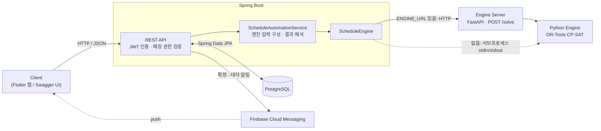
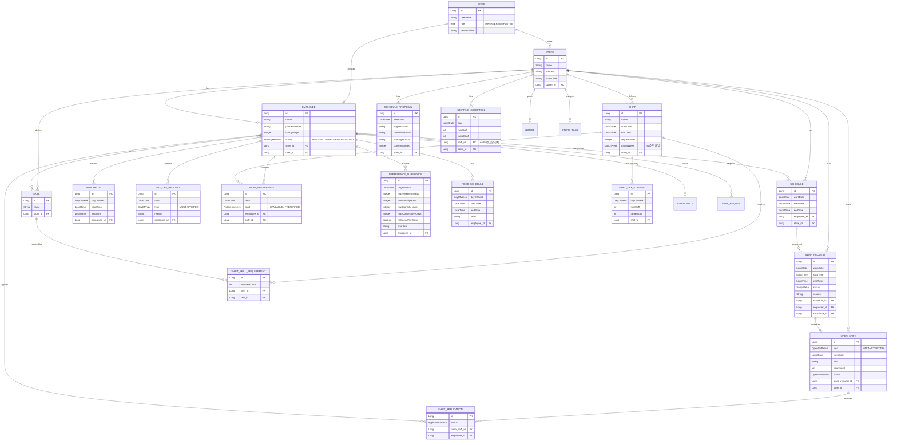
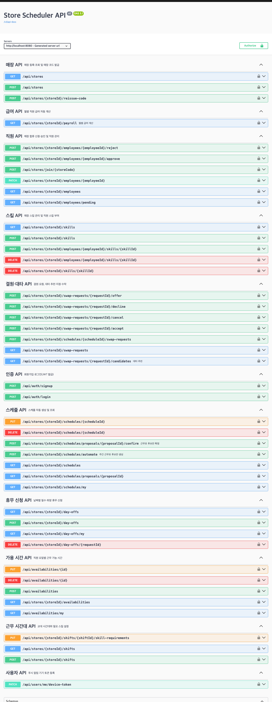

# Store Scheduler Backend
Spring Boot와 Python OR-Tools(CP-SAT Solver)를 결합한 매장 교대근무 스케줄링 API 서버.
직원이 가용 시간과 휴무를 입력하면 근로기준법 제약과 매장 조건(최소 인원·필요 스킬)을 반영한 주간 근무표 후보안을 만들고, 결원이 생기면 대타를 추천한다.


## Tech Stack
- Backend: Java 17 / Spring Boot 4.0.6 / Spring Data JPA / Spring Security + JWT (jjwt 0.11.5)
- Algorithm Engine: Python 3 / Google OR-Tools (CP-SAT) / FastAPI (엔진 서버)
- Database: PostgreSQL 16 (로컬은 Docker Compose), 테스트는 H2
- Docs: Swagger UI (springdoc-openapi 3.0.3)
- Push: Firebase Cloud Messaging (firebase-admin 9.3.0)


## System Architecture


- Spring Boot가 DB에서 직원·교대·가용 시간·휴무·스킬을 모아 엔진 입력 JSON을 만들고 `ScheduleEngine`으로 엔진을 호출한다. 호출 방식은 두 가지이고 입출력 JSON은 같다.
  - **엔진 서버 (FastAPI)**: `ENGINE_URL`을 지정하면 `engine-server`의 `POST /solve`를 HTTP로 호출한다. 엔진을 백엔드와 따로 배포·확장할 수 있다. `ENGINE_TOKEN`으로 백엔드 외의 호출을 막는다.
  - **내장 실행 (기본)**: `ENGINE_URL`이 없으면 `ProcessBuilder`로 같은 서버에서 Python을 실행한다(stdin → stdout). 엔진 스크립트는 클래스패스(`resources/python/`)에 포함되어 기동 시 임시 디렉토리로 꺼내 실행하므로 jar 배포에서도 경로가 깨지지 않는다.
- 엔진 서버와 내장 실행은 같은 `run_engine.solve()`를 쓰므로 결과가 같다.
- 엔진 원본은 [store-scheduler-da](https://github.com/kw-store-scheduler/store-scheduler-da)의 `scheduler_core_0527.py`이고, 백엔드의 `scheduler_core.py`는 같은 파일이다.


## Key Features

1. 주간·월간 근무표 자동 생성 (CP-SAT)
   - `weekStart`(월요일)를 주면 7일, `month`(yyyy-MM)를 주면 한 달 치를 만든다. 월간은 주 52시간·주 15시간을 달력 주마다 따진다
   - 하드 제약: 가용 요일·시간(또는 제출한 희망 칸) 외 배정 금지, 하루 1교대(쪼개기 근무 설정 시 겹치지 않는 2교대), 주 52시간 이하, 연속 5일 근무 금지, 미성년자 22~06시·7시간 초과 교대 금지
   - 인원은 교대 기본값 → 요일별 인원 → 예외일(단체 예약, 휴점) 순으로 덮어써 날짜마다 다르게 넘긴다
   - 최소 인원, 필수 휴무, 필요 스킬 등은 패널티로 처리해서, 인원이 모자라도 근무표는 만들고 부족한 칸을 `shortages`로 알려준다
2. 후보안 비교 후 확정
   - 같은 입력을 기준만 바꿔 세 번 풀어 성격이 다른 후보안을 만든다: 공정 우선(근무일·주말 근무 차이 최소) / 인건비 우선 / 희망 우선(선호 칸·희망 휴무·개인 규칙 우선). 결과가 같은 안은 하나로 합친다
   - 후보안마다 희망 반영률, 주말 근무 최대 차이, 노동법 위반 건수(결과 재검사), 최소 인원 충족률, "최소 인원만 채운 칸" 주의 문구를 계산
   - 생성 단계에서는 근무표를 바꾸지 않고 후보안(최대 3개)만 저장
   - 최소 인원이 필수 휴무보다 우선이다. 누군가의 필수 휴무를 깨야 하면 정규직 휴무를 알바보다 먼저 깨고, 그 칸에는 예비 대타 후보(불가능하면 사유)를 붙인다
   - 인원 부족·휴무 위반 건수를 응답 `notice`로 요약하고 관리자에게 푸시로 알린다
   - 후보안마다 예상 인건비, 기존 근무표 대비 변경 칸 수, 직원별 근무일·시간, 휴무 위반 표시
   - 근무마다 배정 사유 표시 (기존 근무 유지, 필요 스킬 보유, 선호 칸/가능 칸 또는 가용 시간, 이번 주·이번 달 근무 시간과 직원 평균)
   - 관리자가 고른 후보안을 확정할 때만 근무표 교체 + 직원 푸시 알림. 배정 사유는 근무표에 저장해 직원의 "내 근무표"에서 보인다
3. 결원 · 대타 · 근무 바꾸기 · 빈 근무 게시판
   - 결원 신고: 근무 전체 또는 일부(예: 11시부터), 사유 분류(병가·경조사·개인 사정·기타). 사유는 사장님만 본다
   - 직원이 고른 동료들에게 동시에 대타 요청 → 먼저 수락한 1명 → 사장님 승인 → 근무표 반영. 일부 결원이면 근무를 둘로 나눈다
   - 사장님이 보낸 요청(지정·후보 전체 일괄)은 수락하면 바로 확정, 사장님 직접 배정도 가능
   - 30분 동안 아무도 수락하지 않으면 빈 근무 게시판으로 자동으로 넘어간다
   - 후보별 상태(확인 중·응답 없음 N분·거절·승인 대기)와 나에게 온 요청의 예상 급여, 이번 주 근무일 변화, "왜 나에게 왔나요"
   - 약속 점수: 개인 사정으로 빠지고 대타를 못 구하면 -1, 매달 절반씩 회복. 휴무가 겹칠 때 엔진에서 점수가 낮은 사람 휴무를 먼저 깬다
   - 근무 넘기기·맞교환: 근무 48시간 전까지, 동료 수락 → 사장님 승인. 맞교환은 서로 바꾼 상태를 가정해 양쪽 규칙을 검사하고, "매주 이렇게 바꾸기"는 그달 남은 같은 요일·시간 근무에도 적용
   - 빈 근무 게시판: 결원·추가 인원 모집. 필요 역량, 지원 마감, 근무 규칙을 통과해야 지원 가능. 지원자는 이번 달 추가 근무가 적은 순으로 보이고, 상시 5인 이상이면 주 40시간 초과분은 연장근무 50% 가산
   - 추천은 근무표 생성과 같은 규칙으로 가능 여부를 판단하고, 결원으로 모자라게 된 스킬 보유자 → 희망 휴무 아님 → 이번 주 근무 시간 → 시급 순으로 정렬
4. 다음 달 인력 제안
   - 관리자가 날짜·교대별 마감 보고(객수, 매출)를 입력
   - 다음 달 직전 4주의 요일·교대별 평균 객수 ÷ 직원 1명당 감당 객수(매장 설정, 기본 30명)로 필요 인원을 제안하고 현재 설정과 비교(증원·유지·감원)
5. 직원 입력 (다음 달 희망 제출)
   - 지난달 답 불러오기: 지난달 같은 요일·교대에 고른 값과 개인 규칙을 이번 달에 채운 초안(저장은 마지막 단계에서)
   - 날짜×교대 칸을 가능/선호로 고르고, 매주 고정 일정(학업·다른 직장·돌봄)과 겹치는 칸은 잠긴다. 고정 일정은 적용 기간이 끝나면 풀리고, "이번 달만 예외"(시험 기간 등)는 그 기간을 통째로 막는다
   - 다른 직장 근무 시간은 주 근로시간 한도(52시간)에서 빼고 배정한다
   - 개인 근무 규칙: 주말 최대 횟수, 월 근무량 범위, 최대 연속 근무일, 마감 다음 날 오픈 금지
   - 근로계약 주 시간 범위를 이번 달 근무량 기본값으로 쓰고 예상 급여(주휴 포함)를 보여준다. 계약 상한을 넘겨 신청하면 점주가 승인해야 그만큼 배정한다
   - 희망끼리 부딪힐 때 지킬 순서(휴무·선호 교대·주말·근무량·리듬)를 정하면 순위대로 엔진 패널티 배율을 키운다
   - 날짜별 휴무 신청(필수/희망). 필수는 한 달 2일까지이고 넘으면 희망으로 받는다. 희망 휴무에는 안 될 때의 대안 순서를 남기고, "오후만 쉬기"는 엔진에 반영한다
   - 정규직: 날짜×교대 대신 교대별 선호/상관없음/피하고 싶음, 휴무 이틀 붙이기. 휴무 대안에 연차(그날 정규직 필수 휴무만큼)·반차(오후 교대만)를 두고, 이번 달 최대 연차 사용량을 미리 보여준다. 가용 시간을 따로 받지 않으므로 등록하지 않으면 매일 가능으로 본다
   - 희망을 내지 않은 알바는 기존처럼 요일별 가용 시간으로 배정한다
   - 확정 후 희망 반영 리포트: 선호 반영률, 휴무 수용률, 최근 4주 주말·마감·야간 근무의 팀 평균 비교, 반영하지 못한 근무와 사유
6. 역량
   - 역량 등급(상·중·하): 직원이 신청 → 매니저가 확정해야 배치에 쓰인다. 확정·유지는 변경 이력에 남고 직원에게 알림
   - 혼자 맡길 수 있는 일(혼자 오픈·마감 정산·매장 열쇠·발주)은 매니저만 정한다
   - 시간대별 필요 역량: "피크 12–14 응대 상 1명 필수", "화·금 10–12 발주 가능자 1명 우선"처럼 교대와 다른 시간대로 정하면, 그 시간대와 겹치는 교대 중 어디에든 있으면 충족. 필수는 높은 패널티, 우선은 낮은 패널티
   - 수습 기간에는 수습이 아닌 직원과 같은 교대에만 배치(하드 제약). 대타 후보에서도 같은 규칙
   - 엔진에는 등급을 "응대@HIGH" 같은 키로 넘겨, 등급 조건을 스킬 보유 여부로만 판단하게 했다
7. 매장 설정
   - 업종(카페·편의점 등)을 고르면 업종별 스킬과 기본 교대를 만들어 준다
   - 교대 수정·삭제, 요일별 최소·목표 인원, 예외일, 교대별 필요 스킬 인원(예: 오픈에 일본어 가능자 1명), 요일 전용 교대
   - 쪼개기 근무 허용, 다음 달 희망 제출 마감일, 필수 휴무 보장
8. 홈 · 출퇴근 · 공지 · 연차
   - 점주 홈: 이번 주 예상 인건비, 승인 대기, 진행 중인 결원, 오늘 교대별 인원, 출근 기록, 다음 달 희망 제출 현황, 연차 대기
   - 알바 홈: 오늘 근무와 같이 일하는 사람, 이번 주 근무, 나에게 온 대타 요청, 이번 달 예상 급여, 남은 연차(정규직), 최신 공지
   - 출근·퇴근 기록(지각 표시), 공지, 날짜별 업무 체크리스트
   - 정규직 연차: 근로기준법 60조 기준 발생 일수 계산, 신청·승인. 승인하면 그날을 필수 휴무로 등록
9. 급여 자동 계산
   - 월별 기본급 + 주휴수당(주 15시간 이상), 자정을 넘는 근무 처리
10. 인증 · 권한
   - JWT, 관리자/직원 역할 구분, 매장 소속·소유 검증(`StoreAccessGuard`)으로 다른 매장 데이터 접근 차단
   - 로그인 후 `GET /api/users/me`로 역할·소유 매장·합류 상태를 보고 화면을 고른다. 매장이나 합류 신청이 없으면 역할을 바꿀 수 있다
   - 직원 합류 신청 시 고용 형태·닉네임·근무 시작일·미성년자 여부를 받는다


## ERD



## Directory Structure
```text
engine-server/                  # 엔진 HTTP 서버 (FastAPI, POST /solve)
Store_Scheduler_Backend/
 ├── docker-compose.yml         # 로컬 PostgreSQL + (선택) 엔진 서버
 ├── test.http                  # 전체 API 흐름 예제 (IntelliJ HTTP Client)
 └── src/main/
      ├── java/com/example/store_scheduler_backend/
      │    ├── config/          # Security, CORS, Swagger, 예외 처리
      │    ├── controller/      # REST API
      │    ├── domain/          # JPA 엔티티
      │    ├── dto/
      │    ├── repository/
      │    ├── security/        # JWT 발급·검증 필터
      │    └── service/
      │         ├── ScheduleAutomationService  # 엔진 입력 구성 · 결과 해석 · 후보안 생성 · 지표 계산
      │         ├── StaffingPlanService        # 날짜별 최소·목표 인원 (기본값 → 요일별 → 예외일)
      │         ├── PreferenceService          # 희망 제출 · 고정 일정 · 제출 현황
      │         ├── OpenShiftService           # 빈 근무 게시판 · 지원 · 승인
      │         ├── ScheduleProposalService    # 후보안 조회 · 확정
      │         ├── ScheduleEngine             # 엔진 호출 (HttpEngineClient / PythonEngineRunner)
      │         ├── SubstituteFinder           # 대타 추천
      │         ├── PayrollService             # 급여 계산
      │         └── StoreAccessGuard           # 매장 소속 · 소유 검증
      └── resources/
           ├── application.yaml        # 환경변수 기반 설정
           ├── application-local.yaml  # 로컬 개발 기본값 (bootRun 시 자동 적용)
           └── python/
                ├── run_engine.py      # stdin/stdout 연결 스크립트
                └── scheduler_core.py  # CP-SAT 최적화 엔진
```


## Getting Started

### 요구 사항
- Java 17
- Python 3 + OR-Tools: `pip install ortools`
- Docker (로컬 PostgreSQL)

### 로컬 실행
```bash
cd Store_Scheduler_Backend
docker compose up -d postgres   # PostgreSQL 16 (scheduler_db / scheduler / scheduler)
./gradlew bootRun               # local 프로파일 자동 적용 → http://localhost:8080, 엔진은 내장 실행
```
엔진 서버로 분리해서 실행하려면:
```bash
docker compose up -d engine     # http://localhost:8000 (GET /health, POST /solve)
ENGINE_URL=http://localhost:8000 ENGINE_TOKEN=local-engine-token ./gradlew bootRun
```
- Swagger UI: http://localhost:8080/swagger-ui/index.html (우측 상단 Authorize에 로그인 토큰 입력)
- 전체 흐름 예제: `Store_Scheduler_Backend/test.http`를 위에서부터 실행하면 회원가입 → 매장 등록 → 근무표 생성 → 대타 → 급여까지 확인할 수 있다.

### 테스트
```bash
./gradlew test           # H2 사용, Docker 불필요. python3 + ortools가 있으면 실제 엔진 테스트도 실행
```
PR과 main push마다 GitHub Actions(`.github/workflows/test.yml`)에서 OR-Tools를 설치하고 같은 테스트를 실행한다.

### 환경 변수 (local 프로파일 외 실행 시)
| 변수 | 설명 | 기본값 |
|---|---|---|
| `DB_URL`, `DB_USERNAME`, `DB_PASSWORD` | PostgreSQL 접속 정보 | 없음 (필수) |
| `JWT_SECRET` | 32자 이상 서명 키 | 없음 (필수, 미지정 시 기동 실패) |
| `JWT_EXPIRATION_TIME` | 토큰 만료(ms) | 3600000 |
| `PYTHON_COMMAND` | Python 실행 명령 (가상환경 경로 등) | python3 |
| `ENGINE_TIMEOUT_SECONDS` | 엔진 응답 대기 한도 | 60 |
| `ENGINE_URL` | 엔진 서버 주소. 비우면 내장 실행 | 없음 |
| `ENGINE_TOKEN` | 엔진 서버 호출 토큰 (엔진 서버의 `ENGINE_TOKEN`과 같은 값) | 없음 |
| `FIREBASE_CREDENTIALS` | FCM 서비스 계정 키 JSON 내용. 비우면 클래스패스의 `firebase-service-account.json`을 찾는다 | 없음 |
| `CORS_ALLOWED_ORIGINS` | 추가로 허용할 웹 프론트 출처(쉼표 구분). localhost는 포트와 관계없이 항상 허용 | 없음 |

FCM 서비스 계정 키가 `FIREBASE_CREDENTIALS`와 클래스패스(`firebase-service-account.json`) 어디에도 없으면 푸시 알림만 비활성화되고 나머지 기능은 정상 동작한다.

### 배포 (Docker / Render)
- `Dockerfile`: Spring Boot jar와 Python OR-Tools를 한 이미지로 묶는다. `PORT` 환경변수로 포트를 받는다.
- `render.yaml`: Render Blueprint. 웹 서비스와 PostgreSQL을 함께 만들고 DB 접속 정보·`JWT_SECRET`을 자동으로 연결한다.
```bash
docker build -t store-scheduler .
docker run -p 8080:8080 -e DB_URL=... -e DB_USERNAME=... -e DB_PASSWORD=... -e JWT_SECRET=... store-scheduler
```


## API
전체 명세는 Swagger UI, 실제 호출 순서는 `test.http`를 보면 된다. 회원가입·로그인을 제외한 모든 API는 `Authorization: Bearer {token}`이 필요하다.

### 대타 추천 응답 예시
`GET /api/stores/1/swap-requests/1/candidates`
```json
[
  {
    "employeeId": 3, "name": "박세라", "eligible": true, "weeklyHours": 0,
    "coveredSkills": ["일본어"],
    "reasons": ["필요 스킬 보유: 일본어", "희망 휴무 신청일", "가용 시간 09:00~22:00", "이번 주 0시간 근무 중", "시급 11,000원"]
  },
  {
    "employeeId": 2, "name": "이두리", "eligible": false, "weeklyHours": 5,
    "coveredSkills": [],
    "reasons": ["같은 날 다른 근무가 있음"]
  }
]
```


## Troubleshooting

### 1. jar로 배포하면 Python 엔진을 못 찾는 문제
엔진 스크립트를 `src/main/resources/python/...` 상대 경로로 실행하고 있어서 프로젝트 루트에서 `bootRun` 할 때만 동작했다. jar 안에 들어간 파일은 파일 시스템 경로로 열 수 없기 때문이다.
`PythonEngineRunner`를 만들어 기동 시점에 클래스패스의 스크립트를 임시 디렉토리로 꺼내 두고 그 경로로 실행하도록 바꿨다. 고치는 김에 `python` 명령 고정(→ 환경변수), 무제한 대기(→ 타임아웃 후 강제 종료), stderr가 stdout에 섞여 JSON 파싱이 깨지던 문제도 같이 정리했다.

### 2. 한 칸만 모자라도 근무표 전체가 안 나오는 문제 (INFEASIBLE)
처음 엔진은 최소 인원이 하드 제약이라, 특정 날 가용 인원이 한 명만 부족해도 일주일 근무표가 통째로 실패했다. 점주 입장에서는 "못 만듦"보다 "이 칸이 비었음"이 훨씬 쓸모 있다.
그래서 법적 제약(가용 시간, 주 52시간, 연속 근무)만 하드로 남기고 최소 인원·필요 스킬은 큰 패널티로 바꿨다. 채울 수 있으면 채우고, 못 채운 칸은 `shortages`로 응답한다.

### 3. 근무표가 저장되지 않는데 성공으로 응답하는 문제
엔진은 `schedule`(직원 ID + 요일·교대 인덱스)을 반환하는데 자바 쪽은 `schedules`(이름·요일·시간)를 기대하고 있어서, 저장은 0건인데 `success: true`가 나가고 있었다. 직원을 이름으로 찾고 있어서 동명이인도 문제였다.
직원은 `emp_{id}`로 넘기고, 날짜는 월요일 기준 0~6, 교대는 시작 시간순 인덱스로 고정해서 결과를 다시 날짜·시간·직원으로 바꾸도록 했다. 해를 못 찾으면 DB를 건드리지 않고 `success: false`를 준다.

### 4. URL의 storeId만 바꾸면 다른 매장 데이터가 보이는 문제
JWT로 로그인 여부만 확인하고 있어서, 다른 매장 ID를 넣으면 근무표나 직원 가용 시간이 그대로 조회됐다.
여러 서비스에 흩어져 있던 점주 확인 로직을 `StoreAccessGuard`로 모은 뒤, 소속(승인된 직원) 검증을 추가해 조회 API에도 적용했다. 권한 실패는 403으로 응답한다.


## 한계와 다음 단계
- 배정 사유는 백엔드가 결과를 보고 계산한 근거다. 엔진이 실제로 어떤 패널티를 비교해서 골랐는지까지 설명하지는 못한다.
- 후보안 하나당 엔진을 한 번씩 더 풀기 때문에 생성 시간이 최대 세 배 가까이 걸린다. 매장 규모가 커지면 기준별 풀이를 병렬로 돌리거나 시간 제한을 나눠야 한다.
- 예비 대타는 같은 규칙(가용 시간, 하루 1교대, 주 52시간, 연속 근무)으로 고르기 때문에, 조건을 모두 만족하는 사람이 있었다면 엔진이 이미 그 사람을 배정했을 가능성이 높다. 그래서 대부분 "누가 왜 안 되는지"를 보여주는 역할을 한다.
- 필수 휴무는 기본적으로 패널티 방식이라 대신할 사람이 아예 없으면 깨질 수 있다(`dayOffViolations`에 표시). 매장 설정 `guaranteeMustDayOff`를 켜면 그날을 근무 불가로 처리해 절대 배정하지 않고, 대신 빈 칸을 인원 부족으로 보고한다.
- 인력 제안은 요일·교대별 인원을 추천하고 요일별 인원 설정도 생겼지만, 제안을 설정에 자동으로 옮기지는 않는다. 관리자가 보고 요일별 인원에 반영한다.
- 개인 근무 규칙(주말 횟수, 연속 근무, 근무 리듬, 근무량)은 희망 휴무와 같은 단계의 패널티라, 인원이 모자라면 깨질 수 있다. 어떤 규칙이 깨졌는지는 후보안 지표와 희망 반영 리포트로만 보인다.
- 업무 체크리스트는 날짜별로 등록한다. 매일 반복되는 업무 템플릿은 아직 없다.
- 프로필 사진, 소셜 로그인(카카오·네이버·Apple)은 아직 없다.
- Render 무료 배포는 내장 실행 방식을 쓴다. 무료 서비스는 15분간 요청이 없으면 잠들어서, 엔진 서버를 따로 띄우면 첫 근무표 생성 때 두 서비스가 차례로 깨어나며 1분 넘게 걸리기 때문이다. 유료 플랜으로 옮기면 `engine-server`를 별도 서비스로 배포하고 백엔드에 `ENGINE_URL`만 지정하면 된다.


## Branch Strategy
- `main`: 배포 가능한 안정 버전. 직접 push하지 않고 PR로만 병합
- `feat/*`, `fix/*`, `docs/*`: 기능·수정·문서 단위 브랜치 → PR(작업 배경 / 변경 사항 / 검증) → 병합 후 삭제


## Swagger API Documentation
서버 구동 후 http://localhost:8080/swagger-ui/index.html 에서 API 명세 확인 및 테스트 가능.
`POST /api/auth/login`으로 받은 토큰을 우측 상단 Authorize에 넣으면 인증이 필요한 API도 바로 호출할 수 있다.


