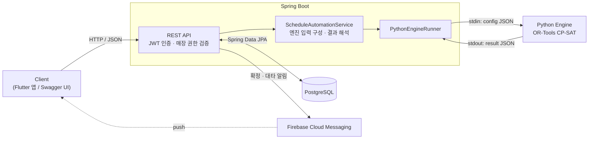
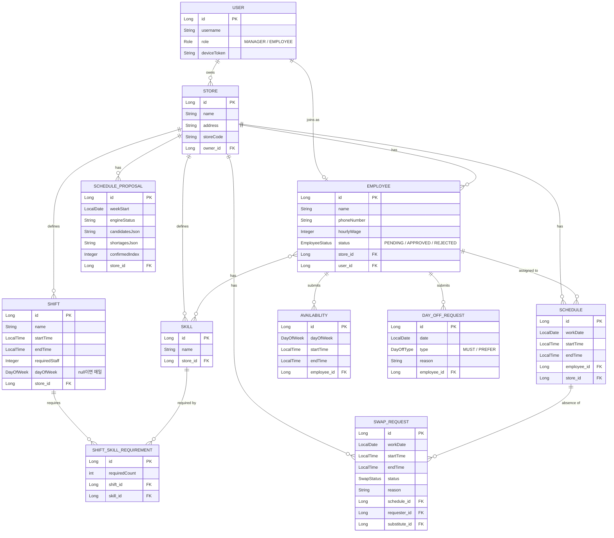

# Store Scheduler Backend
Spring Boot와 Python OR-Tools(CP-SAT Solver)를 결합한 매장 교대근무 스케줄링 API 서버.
직원이 가용 시간과 휴무를 입력하면 근로기준법 제약과 매장 조건(최소 인원·필요 스킬)을 반영한 주간 근무표 후보안을 만들고, 결원이 생기면 대타를 추천한다.


## Tech Stack
- Backend: Java 17 / Spring Boot 4.0.6 / Spring Data JPA / Spring Security + JWT (jjwt 0.11.5)
- Algorithm Engine: Python 3 / Google OR-Tools (CP-SAT)
- Database: PostgreSQL 16 (로컬은 Docker Compose), 테스트는 H2
- Docs: Swagger UI (springdoc-openapi 3.0.3)
- Push: Firebase Cloud Messaging (firebase-admin 9.3.0)


## System Architecture


- Spring Boot가 DB에서 직원·교대·가용 시간·휴무·스킬을 모아 엔진 입력 JSON을 만들고, `ProcessBuilder`로 Python 엔진을 별도 프로세스로 실행한다.
- 입력은 stdin, 결과는 stdout으로 JSON 한 개를 주고받는다. 엔진 오류는 stderr와 exit code로 받아 API 오류로 변환한다.
- 엔진 스크립트는 클래스패스(`resources/python/`)에 포함되며, 기동 시 임시 디렉토리로 꺼내 실행하므로 jar 배포에서도 경로가 깨지지 않는다.
- 엔진 원본은 [store-scheduler-da](https://github.com/kw-store-scheduler/store-scheduler-da)의 `scheduler_core_0527.py`이고, 백엔드의 `scheduler_core.py`는 같은 파일이다.


## Key Features

1. 주간 근무표 자동 생성 (CP-SAT)
   - 하드 제약: 가용 요일·시간 외 배정 금지, 하루 1교대, 주 52시간 이하, 연속 5일 근무 금지
   - 최소 인원, 필수 휴무, 필요 스킬 등은 패널티로 처리해서, 인원이 모자라도 근무표는 만들고 부족한 칸을 `shortages`로 알려준다
2. 후보안 비교 후 확정
   - 생성 단계에서는 근무표를 바꾸지 않고 후보안(최대 3개)만 저장
   - 후보안마다 예상 인건비, 기존 근무표 대비 변경 칸 수, 직원별 근무일·시간, 휴무 위반 표시
   - 근무마다 배정 사유 표시 (기존 근무 유지, 필요 스킬 보유, 가용 시간, 이번 주 근무 시간과 직원 평균)
   - 관리자가 고른 후보안을 확정할 때만 근무표 교체 + 직원 푸시 알림
3. 결원 · 대타
   - 직원이 결원 요청 → 관리자에게 대타 추천 → 지정 → 대상 직원 수락/거절
   - 추천은 근무표 생성과 같은 규칙으로 가능 여부를 판단하고, 결원으로 모자라게 된 스킬 보유자 → 희망 휴무 아님 → 이번 주 근무 시간 → 시급 순으로 정렬
   - 불가능한 직원은 "같은 날 다른 근무가 있음", "연속 5일 근무가 됨" 등 사유 표시
4. 직원 입력
   - 요일별 가용 시간, 날짜별 휴무 신청(필수/희망), 스킬
   - 교대별 필요 스킬 인원(예: 오픈에 일본어 가능자 1명), 요일 전용 교대
5. 급여 자동 계산
   - 월별 기본급 + 주휴수당(주 15시간 이상), 자정을 넘는 근무 처리
6. 인증 · 권한
   - JWT, 관리자/직원 역할 구분, 매장 소속·소유 검증(`StoreAccessGuard`)으로 다른 매장 데이터 접근 차단


## ERD



## Directory Structure
```text
Store_Scheduler_Backend/
 ├── docker-compose.yml         # 로컬 PostgreSQL
 ├── test.http                  # 전체 API 흐름 예제 (IntelliJ HTTP Client)
 └── src/main/
      ├── java/com/example/store_scheduler_backend/
      │    ├── config/          # Security, CORS, Swagger, 예외 처리
      │    ├── controller/      # REST API
      │    ├── domain/          # JPA 엔티티
      │    ├── dto/
      │    ├── repository/
      │    ├── security/        # JWT 발급·검증 필터
      │    └── service/
      │         ├── ScheduleAutomationService  # 엔진 입력 구성 · 결과 해석 · 후보안 생성
      │         ├── ScheduleProposalService    # 후보안 조회 · 확정
      │         ├── PythonEngineRunner         # Python 프로세스 실행
      │         ├── SubstituteFinder           # 대타 추천
      │         ├── PayrollService             # 급여 계산
      │         └── StoreAccessGuard           # 매장 소속 · 소유 검증
      └── resources/
           ├── application.yaml        # 환경변수 기반 설정
           ├── application-local.yaml  # 로컬 개발 기본값 (bootRun 시 자동 적용)
           └── python/
                ├── run_engine.py      # stdin/stdout 연결 스크립트
                └── scheduler_core.py  # CP-SAT 최적화 엔진
```


## Getting Started

### 요구 사항
- Java 17
- Python 3 + OR-Tools: `pip install ortools`
- Docker (로컬 PostgreSQL)

### 로컬 실행
```bash
cd Store_Scheduler_Backend
docker compose up -d     # PostgreSQL 16 (scheduler_db / scheduler / scheduler)
./gradlew bootRun        # local 프로파일 자동 적용 → http://localhost:8080
```
- Swagger UI: http://localhost:8080/swagger-ui/index.html (우측 상단 Authorize에 로그인 토큰 입력)
- 전체 흐름 예제: `Store_Scheduler_Backend/test.http`를 위에서부터 실행하면 회원가입 → 매장 등록 → 근무표 생성 → 대타 → 급여까지 확인할 수 있다.

### 테스트
```bash
./gradlew test           # H2 사용, Docker 불필요. python3 + ortools가 있으면 실제 엔진 테스트도 실행
```

### 환경 변수 (local 프로파일 외 실행 시)
| 변수 | 설명 | 기본값 |
|---|---|---|
| `DB_URL`, `DB_USERNAME`, `DB_PASSWORD` | PostgreSQL 접속 정보 | 없음 (필수) |
| `JWT_SECRET` | 32자 이상 서명 키 | 없음 (필수, 미지정 시 기동 실패) |
| `JWT_EXPIRATION_TIME` | 토큰 만료(ms) | 3600000 |
| `PYTHON_COMMAND` | Python 실행 명령 (가상환경 경로 등) | python3 |
| `ENGINE_TIMEOUT_SECONDS` | 엔진 응답 대기 한도 | 60 |

FCM 서비스 계정 키(`firebase-service-account.json`)가 클래스패스에 없으면 푸시 알림만 비활성화되고 나머지 기능은 정상 동작한다.


## API
전체 명세는 Swagger UI, 실제 호출 순서는 `test.http`를 보면 된다. 회원가입·로그인을 제외한 모든 API는 `Authorization: Bearer {token}`이 필요하다.

### 대타 추천 응답 예시
`GET /api/stores/1/swap-requests/1/candidates`
```json
[
  {
    "employeeId": 3, "name": "박세라", "eligible": true, "weeklyHours": 0,
    "coveredSkills": ["일본어"],
    "reasons": ["필요 스킬 보유: 일본어", "희망 휴무 신청일", "가용 시간 09:00~22:00", "이번 주 0시간 근무 중", "시급 11,000원"]
  },
  {
    "employeeId": 2, "name": "이두리", "eligible": false, "weeklyHours": 5,
    "coveredSkills": [],
    "reasons": ["같은 날 다른 근무가 있음"]
  }
]
```


## Troubleshooting

### 1. jar로 배포하면 Python 엔진을 못 찾는 문제
엔진 스크립트를 `src/main/resources/python/...` 상대 경로로 실행하고 있어서 프로젝트 루트에서 `bootRun` 할 때만 동작했다. jar 안에 들어간 파일은 파일 시스템 경로로 열 수 없기 때문이다.
`PythonEngineRunner`를 만들어 기동 시점에 클래스패스의 스크립트를 임시 디렉토리로 꺼내 두고 그 경로로 실행하도록 바꿨다. 고치는 김에 `python` 명령 고정(→ 환경변수), 무제한 대기(→ 타임아웃 후 강제 종료), stderr가 stdout에 섞여 JSON 파싱이 깨지던 문제도 같이 정리했다.

### 2. 한 칸만 모자라도 근무표 전체가 안 나오는 문제 (INFEASIBLE)
처음 엔진은 최소 인원이 하드 제약이라, 특정 날 가용 인원이 한 명만 부족해도 일주일 근무표가 통째로 실패했다. 점주 입장에서는 "못 만듦"보다 "이 칸이 비었음"이 훨씬 쓸모 있다.
그래서 법적 제약(가용 시간, 주 52시간, 연속 근무)만 하드로 남기고 최소 인원·필요 스킬은 큰 패널티로 바꿨다. 채울 수 있으면 채우고, 못 채운 칸은 `shortages`로 응답한다.

### 3. 근무표가 저장되지 않는데 성공으로 응답하는 문제
엔진은 `schedule`(직원 ID + 요일·교대 인덱스)을 반환하는데 자바 쪽은 `schedules`(이름·요일·시간)를 기대하고 있어서, 저장은 0건인데 `success: true`가 나가고 있었다. 직원을 이름으로 찾고 있어서 동명이인도 문제였다.
직원은 `emp_{id}`로 넘기고, 날짜는 월요일 기준 0~6, 교대는 시작 시간순 인덱스로 고정해서 결과를 다시 날짜·시간·직원으로 바꾸도록 했다. 해를 못 찾으면 DB를 건드리지 않고 `success: false`를 준다.

### 4. URL의 storeId만 바꾸면 다른 매장 데이터가 보이는 문제
JWT로 로그인 여부만 확인하고 있어서, 다른 매장 ID를 넣으면 근무표나 직원 가용 시간이 그대로 조회됐다.
여러 서비스에 흩어져 있던 점주 확인 로직을 `StoreAccessGuard`로 모은 뒤, 소속(승인된 직원) 검증을 추가해 조회 API에도 적용했다. 권한 실패는 403으로 응답한다.


## 한계와 다음 단계
- 배정 사유는 백엔드가 결과를 보고 계산한 근거다. 엔진이 실제로 어떤 패널티를 비교해서 골랐는지까지 설명하지는 못한다.
- 후보안은 비용이 같은 대안들만 나온다. 성격이 다른 안(인건비 우선 / 공평성 우선 등)은 목적함수를 바꿔 다시 풀어야 해서 DA 파트와 논의가 필요하다.
- 필수 휴무는 기본적으로 패널티 방식이라 대신할 사람이 아예 없으면 깨질 수 있다(`dayOffViolations`에 표시). 매장 설정 `guaranteeMustDayOff`를 켜면 그날을 근무 불가로 처리해 절대 배정하지 않고, 대신 빈 칸을 인원 부족으로 보고한다.
- 엔진을 서브프로세스로 실행하고 있어 요청마다 Python이 새로 뜬다. 트래픽이 늘면 엔진을 별도 서버(FastAPI)로 분리할 계획이다.


## Branch Strategy
- `main`: 배포 가능한 안정 버전. 직접 push하지 않고 PR로만 병합
- `feat/*`, `fix/*`, `docs/*`: 기능·수정·문서 단위 브랜치 → PR(작업 배경 / 변경 사항 / 검증) → 병합 후 삭제


## Swagger API Documentation
서버 구동 후 http://localhost:8080/swagger-ui/index.html 에서 API 명세 확인 및 테스트 가능.
`POST /api/auth/login`으로 받은 토큰을 우측 상단 Authorize에 넣으면 인증이 필요한 API도 바로 호출할 수 있다.


